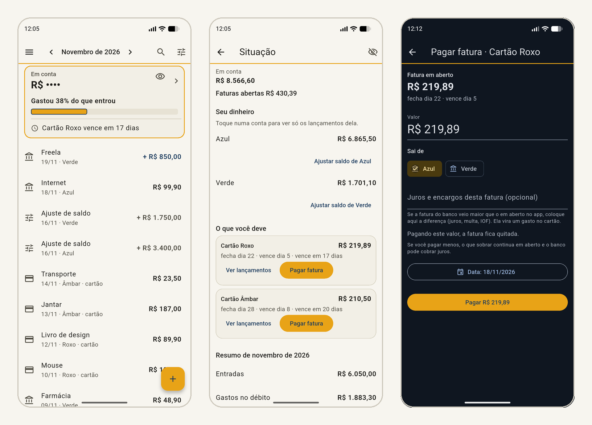

# Ambrio

A personal finance app for Android, for people who already track their money in a spreadsheet and want something more direct. It works
**offline**, needs no account or login, and has no server: your data stays on your device. The app is in Brazilian Portuguese.

> **Status:** version 1.0.4. An open source side project, maintained by one person. Delivery notes are in [`feat/`](feat/README.md) (Portuguese).
> Portuguese README: [README.md](README.md).

## What it does

- **Accounts and credit cards**, with closing and due days per card.
- **Entries** (expenses and income), **transfers**, and **credit card bill payment** (partial payments, optional interest and fees).
- **Situation** screen: balance per account, what you owe on each card (soonest due first) and the month summary.
- **The right month for each card purchase**: the closing day decides which bill, and which month, a purchase belongs to.
- **`.xlsx` import** with optional AI help (see Privacy).
- Search, filters, **backup and restore**, light and dark themes, text size, high contrast, and an in-app guide.

## Install

The app is not on the Play Store. Download the latest `.apk` from [Releases](https://github.com/IziFnc/IziFnc/releases) and open it on your phone
(Android will ask you to allow "unknown sources"). Before installing, **verify the file**: [docs/VERIFICAR.md](docs/VERIFICAR.md) lists the SHA-256 of
each APK and the signing certificate (Portuguese).

## Privacy

No account, no login, no server, no ads: data stays on the device and the developer receives nothing. The exception is the optional AI import: the
service you configure receives the **text** of a sheet (headers, entry names, banks, notes) to locate the tables. **Number and date cells never leave
the device**, and a test enforces that promise. The app asks for your consent per service before the first upload, and you can revoke it at any time.
The AI key is stored in the Android Keystore and is not part of backups. Full text: [PRIVACIDADE.md](PRIVACIDADE.md) (Portuguese).

## Why it is built this way

| Decision | Reason |
|---|---|
| Offline, no account, no server | Financial data is sensitive; with no server there is nothing to leak, and the app works without internet. Accepted cost: no cross-device sync. |
| Money as integer cents | Floating point accumulates rounding errors and balances stop adding up. |
| Computed balances, never stored | One formula for accounts and cards; "Adjust balance" records the difference as an entry. |
| The month comes from the closing day, not the date | A purchase after closing falls on the next bill; each card chooses what to do with a purchase made on the closing day itself. |
| AI only finds the table | Reading the values is deterministic, tested code; the AI only says where a table starts. |

## How it was built

One person, with **Claude Code** as a development partner. Product decisions are mine; the code was written in partnership, and the main lesson was to
**check the AI's work and my own**. More in [docs/PROCESSO.md](docs/PROCESSO.md) (Portuguese).

- **650+ tests** and a CI that runs analysis, tests and a quality gate (`tool/validar.dart`): file size limits, injectable clock, no real spreadsheets
  in the repo, secret scanning. The CI uses no secrets.
- **Database migrations tested** step by step (schema v9); restore rejects tampered files.
- **Every delivery is a note** in [`feat/`](feat/README.md): what changed, **why**, and how to verify it.
- **Signed, verifiable APKs** and a [security policy](SECURITY.md).
- **Contrast is tested**: a test checks the theme color pairs (light, dark, high contrast) against 4.5:1 (7:1 for high contrast).

Two short stories: a CI that stayed green for almost a month while 11 tests failed (a Dart `main` return value does not become the exit code, found
only by forcing a failure on purpose), and a backup restore that worked in tests and debug builds but hung in the release build with the app in use
(found only by testing the real release on a device).

## Developing

Running, testing, building the APK and changing the database: [docs/DESENVOLVIMENTO.md](docs/DESENVOLVIMENTO.md) (Portuguese). Fictional spreadsheets
for testing the import: [docs/exemplo/](docs/exemplo/LEIAME.md).
