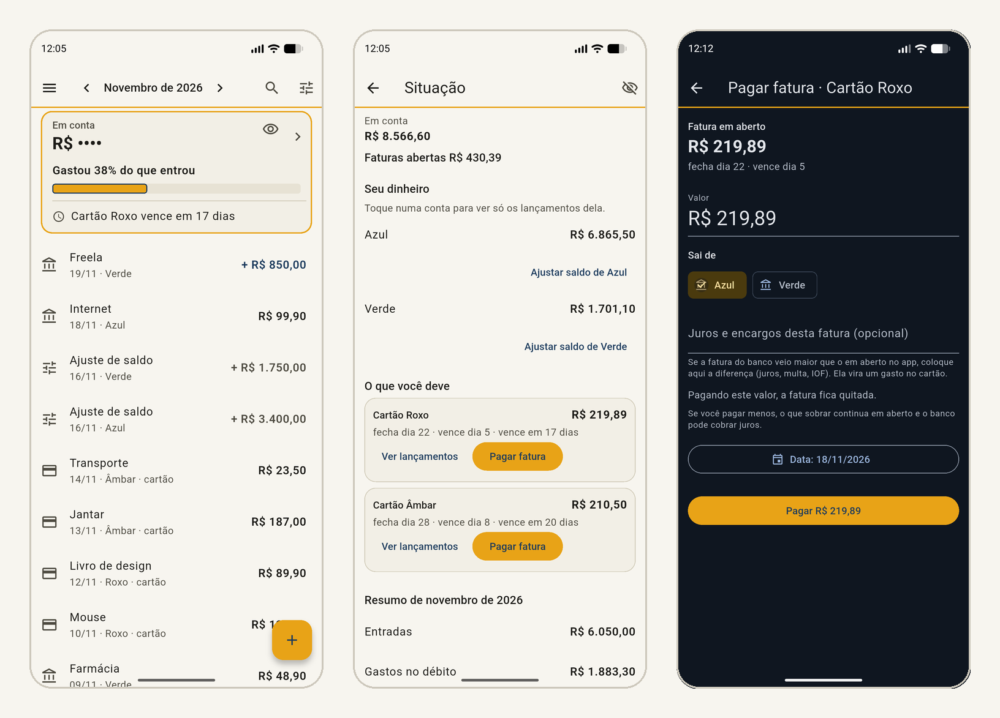

# Ambrio

Controle de finanças pessoais para Android, feito para quem já controla o dinheiro numa planilha e quer algo mais direto. Funciona **offline**,
não pede conta nem login e não tem servidor: os dados ficam no seu aparelho.

> **Status:** versão 1.0.4. É um projeto pessoal em código aberto, mantido por uma pessoa. O histórico de entregas está em
> [`feat/`](feat/README.md). Em inglês: [README.en.md](README.en.md).

## O que faz

- **Contas e cartões**, com o dia de fechamento e de vencimento de cada cartão.
- **Lançamentos** de gasto e de entrada, **transferências** entre contas e **pagamento de fatura** (parcial, com juros e encargos opcionais).
- **Painel na tela inicial**: o quanto do que entrou já foi gasto, numa barra, e o próximo vencimento de cartão; um olhinho esconde os saldos (começam escondidos).
- **Situação**: quanto há em cada conta, quanto se deve em cada cartão (o que vence primeiro aparece primeiro) e o resumo do mês.
- **Mês certo para cada compra no cartão**: a data de fechamento decide em qual fatura e em qual mês a compra entra.
- **Importação de planilha `.xlsx`** com ajuda de IA, opcional (veja em Privacidade).
- Busca, filtros, **backup e restauração**, tema claro e escuro, tamanho de texto e alto contraste, e um guia dentro do app para quem está começando.

## Instalar

O app não está na Play Store. Baixe o `.apk` mais recente em [Releases](https://github.com/IziFnc/IziFnc/releases) e abra no celular. O Android vai
pedir para permitir a instalação de "fontes desconhecidas".

Antes de instalar, **confira o arquivo**: o [guia de verificação](docs/VERIFICAR.md) traz o SHA-256 de cada APK e o certificado de assinatura.

> **Vinha do IziFnc?** O Ambrio é o mesmo projeto com outro nome, mas o Android o trata como outro app, então ele não atualiza por cima. Em
> **Configurações › Dados**, salve um backup no IziFnc, instale o Ambrio e use **Restaurar de um arquivo**. As chaves de IA não vão no
> backup: cole de novo em Configurações › Inteligência artificial.

## Primeiros passos

1. **Contas e cartões** (menu ☰): cadastre as suas contas e, para cada cartão, a conta que paga a fatura e o dia do fechamento (confira no app do banco).
2. **Ajustar saldo** em cada conta e cartão, para o valor de hoje.
3. Lance gastos e entradas no **+**. Para quitar um cartão, use **Pagar fatura** (na Situação ou na tela do cartão).

**Importar a planilha que você já usa** (`.xlsx`, uma aba, um mês por vez): crie uma chave grátis em [console.groq.com/keys](https://console.groq.com/keys),
cole em **☰ › Configurações › Inteligência artificial**, e use **☰ › Importar planilha**. Reimportar a mesma aba não duplica nada. O app lê planilhas
com uma tabela de gastos (`Nome, Valor, Tipo, Banco, Observação, Dia`) e uma de entradas (`Nome, Valor, Banco, Observação, Dia`). **Outros formatos
podem não ser lidos**, e o app avisa quando não acha as tabelas; os limites medidos estão em [docs/exemplo/](docs/exemplo/LEIAME.md).

## Privacidade

Sem conta, sem login, sem servidor, sem anúncio: os dados ficam só no aparelho e quem desenvolve o app não recebe nada. A exceção é a importação
com IA, que você escolhe usar: o serviço configurado recebe o **texto** da aba (cabeçalhos, nomes dos lançamentos, bancos, observações) para achar onde
ficam as tabelas. **Células de número e de data nunca saem do aparelho**, e um teste trava essa promessa. Antes do primeiro envio o app pede a sua
autorização, por serviço, e você revoga quando quiser. A chave de IA fica no Keystore do Android e não entra no backup.
Texto completo: [PRIVACIDADE.md](PRIVACIDADE.md) (também dentro do app).

## Por que é assim

| Decisão | Por quê |
|---|---|
| Offline, sem conta e sem servidor | Dado financeiro é sensível; sem servidor não há o que vazar, e o app funciona sem internet. O custo aceito: não há sincronização entre aparelhos. |
| Dinheiro em centavos, como inteiro | Ponto flutuante acumula erro de arredondamento e o saldo deixa de fechar. |
| Saldo calculado, não guardado | Uma fórmula só, para conta e cartão. Para corrigir, "Ajustar saldo" grava a diferença como lançamento. |
| O mês vem do fechamento, não da data | Compra no cartão depois do fechamento cai na próxima fatura; cada cartão escolhe o que fazer com a compra feita no próprio dia. |
| IA só para achar a tabela | A leitura dos valores é código determinístico e testado; a IA só diz onde a tabela começa. |
| Nunca obrigar categoria | A planilha de origem não tem categoria, e forçar uma reorganização afasta quem só quer migrar. |

## Como foi construído

Uma pessoa, com o **Claude Code** como parceiro de desenvolvimento. As decisões de produto são minhas; o código saiu em parceria, e o que mais
aprendi foi a **conferir o trabalho da IA e o meu**. O processo está descrito em [docs/PROCESSO.md](docs/PROCESSO.md).

- **Mais de 650 testes** e um CI que roda análise, testes e uma porta de qualidade (`tool/validar.dart`): tamanho de arquivo, relógio injetável,
  nenhum `.xlsx` real no repositório, varredura de chaves. O CI não usa nenhum segredo.
- **Migrações de banco testadas** passo a passo (schema v9), e restauração de backup que recusa arquivo adulterado.
- **Cada entrega vira uma nota** em [`feat/`](feat/README.md) com o que mudou, **por quê** e como verificar.
- **APK assinado e verificável**: SHA-256 e certificado em [docs/VERIFICAR.md](docs/VERIFICAR.md); política de segurança em [SECURITY.md](SECURITY.md).
- **Contraste testado**: um teste confere os pares de cor do tema (claro, escuro e alto contraste) contra o piso de 4,5:1, e 7:1 no alto contraste.
- **Testes de usabilidade simulados**: roteiros no emulador e "júris" de agentes que usam o app como uma pessoa nova usaria.

### Duas histórias

**O CI verde que não valia nada.** A porta de qualidade devolvia o resultado como retorno de `main`. Em Dart, esse valor não vira código de saída, então
o CI ficou verde por quase um mês com 11 testes quebrando. Só apareceu quando forcei uma falha de propósito e saiu `exit=0`. Corrigi com
`exitCode` e a regra passou a ser provar que a trava consegue falhar antes de confiar nela: semáforo verde sem prova não vale nada.

**O backup que só travava no app de verdade.** Restaurar um backup funcionava nos testes e no modo de depuração, mas travava no APK de release com o
app em uso, porque o banco não terminava de fechar. Só um teste no aparelho, com o app de release, achou. Hoje o fechamento tem tempo limite e o
roteiro de cada versão inclui restaurar no release.

## Desenvolver

Como rodar, testar, gerar o APK e mexer no banco: [docs/DESENVOLVIMENTO.md](docs/DESENVOLVIMENTO.md).
Planilhas fictícias para testar a importação: [docs/exemplo/](docs/exemplo/LEIAME.md).

## Licença

[MIT](LICENSE): pode usar, copiar, modificar e distribuir, mantendo o aviso de autoria. O app é
oferecido "como está", sem garantia — é um controle financeiro pessoal: confira os valores e
faça backup de vez em quando.

## Histórico de features

Toda entrega significativa vira um arquivo em **[`feat/`](feat/README.md)**, explicando o que mudou, **por que** mudou e como verificar. O `git log`
conta o *o quê*; a pasta `feat/` conta o *porquê*, que é a parte que não dá para reconstruir depois.
